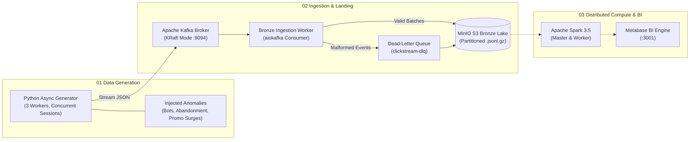

# Real-Time Clickstream Ingestion & Omnichannel Data Warehouse

> **SIC 8 / 2026 Big Data Engineering — Project 05**  
> *Retail, E-Commerce & Customer Journey: Real-Time Clickstream Ingestion & Omnichannel Lakehouse*

An end-to-end Big Data pipeline that simulates concurrent omnichannel customer journeys (web & mobile), streams high-velocity clickstream telemetry through an Apache Kafka broker, lands raw events immutably in an S3-compatible MinIO lakehouse with Dead-Letter Queues (DLQ), and prepares data for distributed PySpark processing and dimensional serving.

---

## Architecture Overview



---

## Features & Implemented Pillars

- **Pillar 01: Domain-Specific Data Generation (`generator/`)**
  - Schema contract defined in `schemas/clickstream_event.json`.
  - Asynchronous generation using `asyncio` and `Faker` to simulate concurrent human journeys.
  - Controlled injection of three domain anomalies:
    1. **Bot Crawlers**: Rapid scraping (<100ms dwell time), predictable paths, non-converting.
    2. **Cart Abandonment**: High cart addition rate of expensive products followed by abrupt exit.
    3. **Promotional Purchase Surges**: Flash sale conversion bursts with promotional coupon tracking.
- **Pillar 02: High-Velocity Ingestion & Immutable Landing (`ingestion/`)**
  - Apache Kafka in lightweight KRaft mode (no Zookeeper dependency).
  - Micro-batching consumer landing raw immutable events to MinIO S3 (`lakehouse-bronze`) partitioned by `year/month/day/hour`.
  - **Dead-Letter Queue (DLQ)** routing and exponential retry backoff.
- **Containerized Infrastructure (`docker/`)**
  - Fully local Docker Compose setup with Kafka, MinIO, Spark Master/Worker, and Metabase.

---

## Prerequisites

Before running the pipeline, ensure you have:

1. **Docker Desktop** installed and running.
2. **Python 3.12+** (tested on Python 3.13).
3. **Git**.

---

## Quickstart & Demo Walkthrough

### 1. Clone the Repository & Setup Environment

```powershell
git clone https://github.com/MennaEzzelarab/realtime-clickstream-pipeline.git
cd realtime-clickstream-pipeline

# Create and activate virtual environment
python -m venv .venv
.venv\Scripts\activate      # On Windows (use source .venv/bin/activate on Linux/macOS)

# Install dependencies
python -m pip install -r requirements.txt
```

---

### 2. Start the Docker Infrastructure

Launch Kafka, MinIO, Spark Master & Worker, and Metabase:

```powershell
docker compose -f docker/docker-compose.yml up -d
```

Verify that all containers are up and healthy:
```powershell
docker ps
```

---

### 3. Initialize MinIO Lakehouse Buckets

Run the initialization script to automatically provision the required S3 buckets (`lakehouse-bronze`, `lakehouse-silver`, `lakehouse-gold`, `spark-checkpoints`):

```powershell
python docker/init_minio.py
```

---

### 4. Run the Real-Time Ingestion Worker (Terminal 1)

Open a terminal and start the ingestion worker. It listens to Kafka topic `clickstream-raw` and flushes batches into MinIO:

```powershell
.venv\Scripts\activate
python ingestion/raw_to_bronze_writer.py
```

You should see:
```text
[INFO] [IngestionBronze] Bronze Ingestion Worker listening on Kafka topic 'clickstream-raw'...
```

---

### 5. Stream Clickstream Events (Terminal 2)

Open a second terminal and trigger the generator to simulate 30 concurrent user sessions across 3 workers:

```powershell
.venv\Scripts\activate
python generator/clickstream_generator.py --mode kafka --bootstrap localhost:9094 --sessions 30 --workers 3
```

Watch **Terminal 1** log the incoming records and flush them to MinIO:
```text
[INFO] [IngestionBronze] [SUCCESS] Flushed 50 raw events to s3://lakehouse-bronze/raw_events/year=2026/month=10/day=21/...
```

---

### 6. Verify and Inspect Data

#### MinIO S3 Web Console
- URL: [http://localhost:9001](http://localhost:9001)
- **Username**: `minioadmin`
- **Password**: `minioadminpassword`
- Navigate to **Buckets** $\to$ `lakehouse-bronze` $\to$ `raw_events/` to inspect the partitioned `.jsonl.gz` data files.

#### Spark Cluster UI
- Spark Master: [http://localhost:8080](http://localhost:8080)
- Spark Worker: [http://localhost:8081](http://localhost:8081)

#### Metabase BI
- URL: [http://localhost:3001](http://localhost:3001)

---

### 7. Verifying the Dead-Letter Queue (DLQ)

To prove fault tolerance and DLQ handling, send an invalid payload missing required identifiers:

```powershell
python -c "import asyncio, json; from aiokafka import AIOKafkaProducer; p = AIOKafkaProducer(bootstrap_servers='localhost:9094', value_serializer=lambda v: json.dumps(v).encode('utf-8')); async def send(): await p.start(); await p.send_and_wait('clickstream-raw', {'corrupted': 'no_event_id'}); await p.stop(); asyncio.run(send())"
```

The ingestion worker will log:
```text
[WARNING] Routing corrupted record to DLQ: Missing critical primary identifiers in event payload
```
The malformed event is preserved in `lakehouse-bronze/dlq/date=YYYY-MM-DD/` and published to Kafka topic `clickstream-dlq`.

---

## Stopping the Pipeline

To gracefully stop the environment:

```powershell
docker compose -f docker/docker-compose.yml down
```